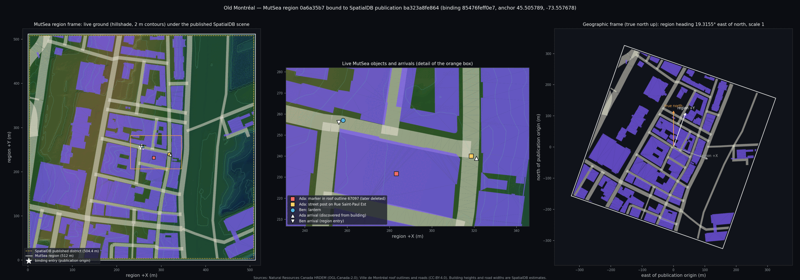

# Prompt 05 acceptance: MutSea geographic world binding

**Verdict: PASS.** On 2026-10-24 a geographically anchored MutSea region operated correctly over
the real SpatialDB Old Montréal publication. The run was on an isolated local grid on an Apple
M1, with two authenticated users over the native protocol. Nothing was pushed or deployed. No
production service, database or Codex runtime was touched.



The left panel shows MutSea's live ground, with the published SpatialDB buildings and roads
drawn over it from the correspondence index. The middle panel shows live objects and arrivals
from the acceptance run, placed through the binding from their reported WGS84 positions. The
right panel shows the same district with true north up and the region square at its calibrated
heading.

## Requirements

| Requirement | Result | Evidence |
|---|---|---|
| Real geographic district | PASS | SpatialDB publication `ba323a8f…` (root `bf7be877…`), Old Montréal around Place Jacques-Cartier. Inputs: NRCan HRDEM (OGL-Canada-2.0), and Ville de Montréal roofs and roads (CC-BY-4.0). Every root, subtree, geography and mesh byte is hash-verified on use. |
| Corresponding MutSea region | PASS | "Old Montreal", a 512 × 512 m var region `0a6a35b7…` in world `46f08830…`, issued binding revision 1, version `85476fef…`. |
| Geographic anchors, orientation, scale | PASS | Anchor 45.505789449°, −73.557678497°, h −31.511 m (region origin). Heading 19.315533° (published grid north at the anchor). Scale 1. |
| Region ↔ geographic transforms | PASS | Exact f64 WGS84 similarity. Three independent implementations (C#, numpy/pyproj, JavaScript) agree to 3 nm. |
| Stable world and region identity | PASS | Explicit world UUID, native region UUID, and a binding ID derived from both. All unchanged across reconnect and restart. |
| Versioned bindings | PASS | Content-addressed RFC 8785 version, reproduced byte for byte in JavaScript. Revision chain, retirement and journal are covered by tests. |
| Entity correspondence | PASS | All 139 published features (42 buildings, 93 roads, 4 terrain tiles) indexed in both directions. Live: an object inside roof outline 67097 reports that building, and the building lists the object. A post placed on Rue Saint-Paul Est reports that street. |
| World-entry discovery | PASS | Public read-only `/finalverse/geo/v1/worlds` and `/entry`. Earth Core's own validators accept the served projections (18/18 twice). Outside → 404, write → 405, malformed → 400. |
| Authorization-preserving handoff | PASS | Discovery carries no identity or credential and says `authorization: "required"`. Native login at the discovered start location. `geo_enter` receipts recorded 0.324 m and 0 m arrival error. A stale binding version is refused. |
| ≥ 2 authenticated users, concurrent | PASS | Ada and Ben logged in concurrently over native login and UDP. Each observed all of the other's objects. |
| Persistent object identity | PASS | Same UUID, owner and transform after reconnect and after a normal simulator restart. Geographic position unchanged to < 1 cm. |
| Object creation and deletion | PASS | Four creates, one rename and two deletes through WorldKernel and WorldLine (seven commits). The other user observed each over UDP, including a deletion after reconnect and one after restart. |
| Reconnection without identity loss | PASS | Same agent UUID, a new capability, objects and ownership intact. The old capability no longer reaches the World API. |
| No unauthorized mutation | PASS | Refused: Ben's delete and move of Ada's object, commit of Ada's plan, undo of Ada's plan, and binding issue. Ben's native UDP move and take-to-inventory changed nothing. A stale plan after a concurrent commit was refused. |
| WorldLine audit | PASS | Seven commits, each with an intent record. No refused attempt appears in WorldLine; each refusal is in the request log as HTTP 400. The binding journal holds issue intent, issued, and two entry receipts. |

## Geodesy and calibration (measured)

- **Grid convergence:** the published terrain grid (EPSG:3979 Lambert) runs 19.31851° east of true north at the district centre, measured from the meshes. PROJ gives 19.31879°. Region +Y follows the published grid; the residual is 0.00032° (1.4 mm over 256 m).
- **Scale:** the projection's point scale is k = 1.01501, so the "512 m" published square is 504.43 true metres. The binding keeps scale 1, so simulation metres are true metres. That leaves an explicit 3.79 m margin: 7,119 samples (2.7%) take the nearest published surface point, at most 5.36 m away.
- **Vertical:** N_eff = h − H = −31.501 m at the publication origin (CGG2013a plus the NAD83(CSRS)→WGS84 Helmert shift). The geoid varies 7.4 mm across the district. Region z equals CGVD2013 height at the origin; across 7,225 source DTM samples, z − H stays within 3.0 cm (mean −3.1 mm).
- **Solve residuals:** the publication origin lands at region (256, 256, 19.0702) with 0.84 nm horizontal and 0.94 nm vertical residual (independent oracle).
- **Ground versus the published triangles:** RMS 7.0 mm and maximum 0.182 m over 20,000 random points; integer samples within 0.5 mm. A 1 m heightmap cannot follow a sub-metre slope break of the 4 m published triangles, as at quay walls. The binding declares this rather than hiding it.
- **Live ground:** at 30 random geographic points inside the region, live MutSea ground equals the issued heightmap to 3.5 nm.
- **Ground versus the source 2 m DTM:** RMS 8.5 cm, p95 12.6 cm, p99 34 cm, maximum 2.14 m. This mostly reflects SpatialDB's 4 m publication LOD, not the binding.
- **Determinism:** recalibrating from the second publication copy produced bit-identical binding, correspondence and terrain. Calibration takes 0.46 s.

## Tests

| Suite | Result |
|---|---|
| `tools/Finalverse.GeoTests` | 28 passed: 24 contract (SpatialDB and PROJ golden vectors, heading/scale semantics, antimeridian/polar/southern round trips, JCS vectors, tamper rejection, correspondence, journal issue/revise/retire/compensation/fencing, entry bounds) + 4 on the real binding. Added to CI. |
| `tools/Finalverse.WorldTests` (existing) | 61 passed, unchanged. |
| `tools/geo/geo_oracle.py` | Independent pyproj and numpy verification (`evidence/oracle-verify.json`). |
| `tools/geo/core-conformance.mjs` | 18/18 against the served point and building entries, with Earth Core 0.1.0 validators. |
| `tools/Finalverse.GeoProbe` | Session 33/33, restart 9/9 on the live isolated grid. |

Median client-observed latency on the local grid:

| Operation | Median |
|---|---|
| `geo_resolve` | 5.6 ms (n = 40) |
| `geo_entity` | 5.7 ms |
| `geo_locate` | 5.9 ms |
| `geo_enter` (journaled) | 88 ms |
| `prepare` | 8.2 ms |

These are from a single local run, not a benchmark.

## Limitations

- **Accuracy is inherited.** Geographic accuracy is SpatialDB's: datum operation accuracy is 1 m, and source accuracy and coordinate epoch are uncertified. MutSea↔SpatialDB alignment is exact by construction (nm); Earth-absolute accuracy is not claimed beyond the publication's.
- **Buildings are not live geometry.** Buildings and roads are SpatialDB representations. Avatars stand on terrain inside building footprints, and the correspondence reports it. Collision proxies would need a separate, explicitly approved representation.
- **No water.** The publication has no hydrography. Water is placed below the lowest published ground (5.6 m), so MutSea shows none.
- **Sign-in is native.** The handoff uses native MutSea credentials. There is no Earth↔MutSea single sign-on; the entry descriptor states that authorization is required.
- **Dead capabilities answer 200.** A revoked capability URL gets the inherited HTTP server's default empty `200 text/html`, not a 404. Nothing executes.
- **Client terrain decode.** The protocol client library does not decode var-region `LandExtended` terrain patches. Ground was verified through the World API and the heightmap, not client-side terrain.
- **One region per binding.** Multi-region districts and region crossings are not exercised.
- **Not yet tested:** a revision issued in the live runtime (covered only by unit tests), and Desktop or FinalStorm rendering of MutSea objects through `region_to_publication` (that is Prompt 06 work).

## Reproduce

Runtime: `~/Finalverse/dev/mutsea-geo-20261024`. Image `mutsea:confluence-v07` runs with `-dit` on
private network `mutsea-geo-20261024`, port 19070. PostgreSQL is `postgres:16-alpine`. Secrets
are in owner-only files under `runtime/secrets`.

```sh
# candidate (oracle supplies the geoid inputs)
python -I tools/geo/geo_oracle.py inputs <spatialdb worker> <source dir> <geography.json>
DOTNET_ROLL_FORWARD=Major dotnet Finalverse.GeoBind.dll --publication <dir> --root-sha bf7be877… --world-id … --region-id … \
  --region-name "Old Montreal" --size 512 --geoid-undulation -31.500983968377113 --geoid-variation 0.0074072349816560745 --geoid-grid-sha afa759d1… --out candidates
python -I tools/geo/geo_oracle.py verify … candidates/<v>.binding.json candidates/<v>.terrain.r32
# tests
dotnet run --project tools/Finalverse.GeoTests -c Release -- candidates/<v> <publication dir> oracle-verify.json
node tools/geo/core-conformance.mjs <earth-core dist/index.js> candidates/<v>.binding.json discovery-worlds.json discovery-entry-point.json
# live acceptance: reset, discovery, session, graceful restart, restart checks, journals
tools/run_acceptance.sh
```

Native probes must link the portable client SDK
(`dev/phase4b/protocol-smoke-streaming-portable-20261010`, `OpenMetaverse.dll` `55dfe9…`). The
simulator's server build calls a Windows-only `Socket.IOControl` when it opens UDP on macOS.
This host has only .NET 10, so net8 tools run with `DOTNET_ROLL_FORWARD=Major`.

## For Prompt 06

Earth Web, CesiumJS and FinalStorm should consume
`GET http://127.0.0.1:19070/finalverse/geo/v1/worlds` and `/entry?spatialdb_entity=<building>`.
Contract and snippets are in [world-binding.md](world-binding.md).

- Place region-local positions with `region_to_ecef`, a column-major Cesium `Matrix4`.
- In FinalStorm, use `region_to_publication` instead of the translation-only `--world-origin`.
- Enter with the native `login.start`, confirm with `geo_enter`, and return to Earth with `geo_locate.return_destination`.
