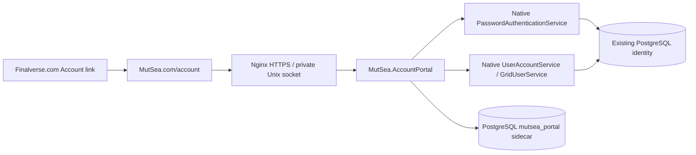

# MutSea / Finalverse account portal

Create a limited-preview world account or manage an existing one at
[mutsea.com/account/](https://mutsea.com/account/). The Account link on both
websites opens this portal. Use the **same avatar first name, last name and
password as the Finalverse viewer**. There is no second Finalverse password.

## For users

1. Open the HTTPS portal. New users choose **Create your world account**, a first and last avatar name, a pinned starter avatar and a password. Wait for **Account ready**. Existing users enter `First Last` and their current world password. An avatar UUID or email is not a login name.
2. Your World shows your avatar ID, account creation date, registered email,
   home region, last known region and world status. Location/status may lag by
   five minutes. Signing in on the web does not log your avatar into the world.
3. Web Profile saves an About description, optional contact email and preferred
   contact language. These are web preferences, separate from the in-world
   profile. The optional email is **unverified** and cannot recover a password.
4. Generate recovery codes after confirming your current password. Save them in
   a password manager; the portal shows them only once. Generating a new set
   replaces the old set.
5. Change Password updates the world credential and signs out all web sessions.
   Use 12–16 printable ASCII characters: the released viewer's login field has
   a 16-character limit. Sign back in and generate new recovery codes.

If you forget your password, expand **Reset a forgotten password** on the
sign-in page. Enter your avatar name, a saved code and the new password. A reset
invalidates **all** previous codes and browser sessions. Existing in-world
connections are not forcibly disconnected; their next login uses the new password.
If you have no code, contact pilot support and prove ownership. Never send a
password or recovery code by email. There is no automated email reset yet.

Use World → Teleport Home in the viewer to travel home. Set Home to Here remains
a viewer operation because the native region must validate land permissions.
The portal does not bypass that check.

Limited preview registration prepares a native identity, six base wearables,
Genesis alpha and mesh attachments, current-outfit links and a persistent starter
home before activating login. The website and viewer share the same password.
Choose **Finalverse Harbor (Preview)** (`https://grid.mutsea.com/`) in the viewer;
Second Life accounts and grids are separate. Preview.2 users can reveal the grid
selector with ⌘⇧G and should use the web registration link instead of its inherited
Sign up button. The newer viewer makes the grid visible and routes MutSea signup
and recovery to this portal.

Registration is capacity-limited and pauses if the native worker has not reported
readiness within 60 seconds. No invitation is needed while it is enabled. It is
still an experimental service, without verified-email reset, MFA or a commercial
availability commitment.

## Architecture and boundaries



The ASP.NET Core 8 adapter calls the **actual native service assemblies from the
tested simulator image**. It does not copy the native hashing implementation,
call a public simulator administration endpoint, create a viewer presence session,
or expose inventory/world mutation. Authentication uses the native MD5 client
password contract; the inherited salted-MD5 storage is unchanged. A future
password-storage migration must preserve viewer/protocol compatibility.

`PasswordAuthenticationService(config)` is constructed without the account-service
impersonation fallback. Its short authentication token is released immediately.
`GridUserService` assumes a native console registry; the adapter supplies an inert
`CommandConsole` registry with **no reader, listener or dispatcher**.

Active local native accounts are looked up by name, then every protected action
derives the avatar ID from its session. Negative user levels and the system grid
services identity are excluded. There are no user IDs, roles or permission flags
accepted in profile/password request bodies.

The deployed world has no native user-profile service configured. The web profile
is therefore an explicit sidecar, not a claim that an in-world biography changed.
Native account email/name, home and last-location values remain read-only.

Finalverse.com remains a static site that links here. This is a shared account
authority, **not cross-domain cookie SSO or an OIDC implementation**. Future
interactive clients should adopt a standard authorization-code flow with PKCE
instead of sharing cookies between unrelated domains.

## Security contract

- Opaque 256-bit browser session identifiers; only SHA-256 digests are persisted.
  `__Host-mutsea-session` is Secure, HttpOnly, SameSite Strict, Path `/`, with no
  Domain attribute. Sessions expire after 12 hours or 30 minutes idle.
- POST requires the exact `https://mutsea.com` Origin, JSON content type and a
  matching `X-MutSea-CSRF` header/cookie. Tokens rotate at sign-in and security
  transitions. No CORS, arbitrary redirect destination or browser token storage.
- Current-password reauthentication for password changes and code generation.
  Six 128-bit recovery codes are shown once, stored only as digests and tied to
  the current native credential fingerprint.
- An HMAC of native credential state is checked on each session validation.
  Native/admin password rotation therefore invalidates old web sessions/codes,
  even if native commit succeeds but sidecar cleanup fails. This does **not**
  claim a distributed transaction across the inherited service and sidecar.
- Per-avatar PostgreSQL advisory locks serialize security changes. Concurrent
  reset attempts with one code accept exactly one. Versioned profile updates
  reject stale edits with 409.
- Persistent keyed-digest rate limits: 10 attempts per name and 40 per IP, per
  15-minute bucket, separately for login, reset and sensitive account actions.
  Login/reset responses have a minimum 350ms delay. This reduces simple timing
  differences; it is not a claim of perfect timing indistinguishability.
- Strict JSON field allowlists, duplicate-field rejection, 16KiB body limit,
  eight concurrent request slots, database command timeouts and a bounded pool.
- No passwords, bodies, recovery codes or session values in application logs.
  Nginx sees ordinary request metadata. API responses are `no-store` and
  `no-referrer`; pages use the site's restrictive CSP.
- The private service listens only on a Unix socket. Its restricted database
  role can read native identity/home/auth metadata, update existing auth records
  and manage native short tokens. It has **no** native user-account/role writes,
  world-object/asset/inventory access or native migration privileges.
- Separate sidecar schema stores sessions, profiles, recovery digests, rate
  buckets and a 90-day security audit. Expired sessions/rate buckets are pruned
  every 15 minutes. Recovery codes persist until replacement/password rotation.

An exposed service with password-update capability remains a sensitive service.
Keep its database role, HMAC key, config and backups private and access-controlled.
MFA and verified-email delivery remain subsequent work. See the [registration provisioning contract](registration.md) for queue security, limits and deployment.

## API used by the portal

| Method | Path under `/account/api/` | Purpose |
|---|---|---|
| GET | `session` | Anonymous CSRF bootstrap or own authenticated identity/profile |
| GET | `registration-options` | Native readiness and allowlisted starter choices |
| POST | `register` | `firstName`, `lastName`, `password`, `email`, `avatar`; queue native provisioning |
| GET | `registration-status` | Own provisioning result, bound to HttpOnly receipt |
| POST | `login` | `name`, `password`; issue an opaque session cookie |
| POST | `logout` | Revoke current session and expire its cookie |
| POST | `profile` | `about`, `contactEmail`, `language`, `version`; own profile only |
| POST | `recovery-codes` | `password`; replace code set after reauthentication |
| POST | `password` | `currentPassword`, `newPassword`; native credential update |
| POST | `reset` | `name`, `code`, `newPassword`; saved-code recovery |

All writes require Origin/CSRF, including login and reset. No credential belongs
in a URL or query string. There is no administrative user-list/reset endpoint.

## Build and tests

Use the same native assemblies as the world being connected. `MutSeaBin` must
point at that image's DLL directory. No simulator rebuild is required:

```sh
dotnet build apps/MutSea.AccountPortal.Tests/MutSea.AccountPortal.Tests.csproj \
  -c Release -p:MutSeaBin=/absolute/path/to/tested/native/bin -o /tmp/mutsea-account-tests
dotnet /tmp/mutsea-account-tests/MutSea.AccountPortal.Tests.dll

docker build -f deploy/accounts/Dockerfile \
  --build-arg MUTSEA_NATIVE_IMAGE=your-tested-native-image \
  -t mutsea-accounts:your-version .
docker run --rm --network none --read-only --tmpfs /tmp --cap-drop ALL \
  --entrypoint dotnet mutsea-accounts:your-version /tests/MutSea.AccountPortal.Tests.dll
```

The core/HTTP suite checks credential transitions, expiry, disabled accounts,
partial cleanup failure, ownership, CSRF, strict fields, cookie deletion and
recovery/password routes through a real Kestrel server. Its fake identity exists
only in the test executable; the production entry point always constructs the
native identity adapter.

`--native /fixture/fixture.json` adds real PostgreSQL/native integration checks.
It **refuses any database not named `mutsea_accounts_fixture_*`**, including its
bootstrap admin connection. Create a disposable schema-only native fixture,
copy only migration-version records, then run `schema.sql` there. Its private
JSON contains `ConnectionFile`, `AdminConnectionFile`, `KeyFile`, `PasswordFile`;
each points to a mode-0600 file inside the test container. The restricted
connection has the portal grants; the fixture-only admin connection seeds a
synthetic identity/home. Never mount those admin files into production.

Validated on October 17, 2026: **72 core/HTTP checks on macOS, 75 on Linux (including Unix socket type checks),
14 native PostgreSQL checks, 26 PostgreSQL registration checks and 8 running-world registration checks repeated after restart**, public TLS sign-in/home/logout, a forced process stop/restart with a
persistent browser session, and browser profile save/reload/restore. The browser
could not finish direct public-page navigation in the test environment, so UI
QA used a private loopback proxy to the deployed HTTPS site; separate HTTP checks
verified the real Secure/host-only cookie contract. Do not deploy that QA proxy.

## Deployment and rollback

See [deploy/accounts/README.md](../../deploy/accounts/README.md). Changes are an
independent private service, an additive sidecar schema and a scoped website
proxy. The simulator image, UDP routing, world state and admitted users are not
replaced. Restore the previous website vhost/release to remove public exposure;
stop only the account container if necessary. Keep sidecar data and keys for
rollback. Do not restore an old native auth backup over newer user passwords.
