# Starter content import — Phase 4B

The first runtime adapter wraps inherited mesh serialization, asset storage, scene insertion, permissions, backup and UDP streaming. It does not execute Blender/Python content or let an LLM write simulator state.

```mermaid
flowchart LR
    A[Blender authoring] --> B[Hash and semantic manifest validation]
    B --> C[Offline native mesh compiler]
    C --> D[Operator approved read-only catalog]
    D --> E[Session-bound preview]
    E --> F[Native policy revalidation]
    F --> G[Durable intent]
    G --> H[Native asset and scene executor]
    H --> I[Content WorldLine result]
    I --> J[Scene and semantic observation]
```

## Actual module boundary

`ContentKernel` owns previews, deterministic instance IDs, the append-only content journal and guarded Undo. `ContentCatalog` loads a bounded read-only directory selected by the operator. `ContentModule` adapts native `AssetService`, `SceneObjectGroup`, parcel permissions, backup and update scheduling. `ContentFingerprint` verifies the exact native object state before deletion. `WorldModule` exposes these operations through the existing authenticated region-session capability, and includes semantic records in world inspection.

The module exports `content_preview`, `content_commit`, `content_history`, `content_undo` and the existing `semantic` operation. A preview expires after two minutes and belongs to one active region session. Native policy runs again at commit. Placement requires parcel rez permission, a nearby avatar, dry flat ground, a small footprint and clearance from every existing object/path. The initial catalog accepts original CC0 asset packages only: at most 32 parts, 4096 triangles and a four-metre footprint radius. Places, buildings, rigged avatars, textures and general uploaded packages remain outside this adapter.

The offline compiler preserves the source manifest hash and mesh hashes. Native COLLADA identity-node normalization occurs in adapter output, leaving original authoring files intact. Each bounded mesh shares its high geometry across four LOD references; this retains silhouette but is not a finished LOD optimization pipeline. Static convex collision requires native viewer behavior testing.

## Semantic persistence

Compiled format v2 carries tags, affordances and local relationships in addition to names, types and descriptions. The server compares them with the hash-pinned original manifest, validates relationships and persists them in the transaction plan. Queries resolve relationship targets to the instance's canonical entity UUIDs. Older compiled v1 catalogs hydrate this metadata from their pinned manifest. Historical v1 journal entries without metadata explicitly report `semantic_metadata_available=false` rather than inventing it.

The coastal bench v0.1.1 has a seating root with `sit` and `inspect`, and twelve components related to that root. Declaring `sit` is semantic metadata; successful native sitting/animation has not yet been verified. Existing v0.1.0 authoring exports remain intact. Templates carry local IDs, and the executor assigns instance IDs; they do not assign owners or canonical world privileges.

## Failure and Undo behavior

A durable intent precedes world insertion. The native asset store must acknowledge each requested mesh UUID. An insertion failure that leaves partial or unobservable scene state blocks subsequent world/content mutations and citizen writes/navigation. An incomplete intent also blocks writes after restart. Read/stop operations remain available. There is no automatic destructive recovery endpoint; an operator must reconcile recorded IDs and native state before clearing a recovery condition.

Undo requires the original actor, native delete permission and an unchanged native fingerprint, including transforms, owner, permissions, mesh/material bindings, physics and object inventory. UUID sorting and signed-zero normalization preserve fingerprints across native persistence without permitting later edits. Deletion must be observable before an `undone` result is recorded.

The journal is durable logical coordination, not one atomic PostgreSQL-plus-filesystem transaction. Failed attempts may leave unreferenced mesh assets. Asset garbage collection and an operator recovery workflow remain unfinished. Content history is available through the API but does not yet have its own viewer import/history UI.

## Verified evidence — 2026-10-09

- 24 kernel/catalog/failure tests, including metadata tampering, canonical relationships, interrupted imports and failed state observation.
- Six tests against real native object/XML persistence and fingerprints, including rejection after transform, owner, permission, mesh or material edits.
- 51 existing world/navigation tests and 16 package validator tests.
- A path lantern rendered in the packaged macOS viewer before the PostgreSQL cutover; its import, restart and Undo checks passed.
- Bench v0.1.1: 13 native mesh parts, 1404 triangles and two materials imported into the PostgreSQL fixture. Actual UDP mesh bindings and all 13 semantic records passed after a complete database/simulator restart. Guarded Undo removed the instance and semantic projection; a fresh instance is retained for visual testing.
- Coastal tree v0.1.1: three linked mesh parts, 1084 triangles and three materials passed native import, UDP streaming, all three semantic records and two canonical component relationships in the local PostgreSQL fixture. The same instance survived simulator restart and passed guarded Undo/removal verification. This compact authoring draft has not replaced Harbor vegetation; viewer rendering, collision and performance remain pending.
- Fresh remote x86-64 PostgreSQL deployment: the same bench imported through verified gateway HTTPS and native LAN UDP, including all thirteen semantic records. Restart, guarded Undo and verification of removal passed with the final module build. A fresh bench is retained, and all 40 original Harbor identities/transforms passed again. This is LAN acceptance, not public world entry.
- Lumi's identity, autonomy, seven embodiment components, semantic home, memories and goal history passed the same restart audit.

Bench rendering, sitting, collision and controlled performance measurements remain pending because the Mac locked before the visual check. This is a working bounded import seam, not Phase 4B completion or a general Studio live-link implementation. Pavilion-scale placement, Harbor composition, environments and avatar art remain subsequent content gates.
