# Starter content import — Phase 4B

The first runtime adapter wraps inherited mesh serialization, asset storage, scene insertion, permissions, backup and UDP streaming. It does not execute Blender/Python content or let an LLM write simulator state.

```mermaid
flowchart LR
    A[Blender authoring] --> B[Hash and semantic manifest validation]
    B --> C[Offline native mesh compiler]
    C --> D[Operator approved read-only catalog]
    D --> E[Session-bound preview]
    E --> F[Native policy revalidation]
    F --> G[Durable intent]
    G --> H[Native asset and scene executor]
    H --> I[Content WorldLine result]
    I --> J[Scene and semantic observation]
```

## Actual module boundary

`ContentKernel` owns previews, deterministic instance IDs, the append-only content journal and guarded Undo. `ContentCatalog` loads a bounded read-only directory selected by the operator. `ContentModule` adapts native `AssetService`, `SceneObjectGroup`, parcel permissions, backup and update scheduling. `ContentFingerprint` verifies the exact native object state before deletion. `WorldModule` exposes these operations through the existing authenticated region-session capability, and includes semantic records in world inspection.

The module exports `content_preview`, `content_commit`, `content_history`, `content_undo` and the existing `semantic` operation. A preview expires after two minutes and belongs to one active region session. Native policy runs again at commit. Placement requires parcel rez permission, a nearby avatar, dry flat ground, a small footprint and clearance from every existing object/path. The initial catalog accepts original CC0 asset packages only: at most 32 parts, 4096 triangles and a four-metre footprint radius. Places, buildings, rigged avatars, textures and general uploaded packages remain outside this adapter.

The offline compiler preserves source manifest, mesh and material hashes. Native COLLADA identity-node normalization occurs in adapter output, leaving original authoring files intact. Optional lower-level Collada payloads are independently loaded, aligned to the high mesh's quantization domain, and serialized with the inherited `ModelPrim.CreateAsset`. Their native LOD blocks have separate offsets. Legacy packages retain shared high geometry and remain outside production LOD acceptance. Static convex collision is per small part and still requires native viewer behavior testing.

## Native PBR gate

Compiled v3 packages pin bounded linear base-color, metallic, roughness, emissive, alpha and sidedness factors to their original semantic manifest. `ContentMaterialAsset` wraps one canonical glTF 2.0 material in the viewer's existing LLSD AT_MATERIAL format, version 1.1. `ContentModule` stores that asset through the native asset service and binds each face using inherited `PrimitiveBaseShape.RenderMaterials` extra parameters. `ViewerAsset?material_id=...` serves it; the inherited viewer glTF material loader and shaders consume it.

The original loss occurred between Blender authoring and the native compiler: GLB retained PBR factors, but runtime import used Collada diffuse colors and emitted only legacy face tints. The new pinned material definition/binding adapter carries those factors independently of the legacy diffuse fallback. Both paths retain their correct linear/sRGB representations. It is not a proprietary material shader.

The viewer's `LLFace::getGeometryVolume` selects `mBaseColor` when a glTF render material is present, replacing the legacy texture-entry color. `pbropaqueF.glsl` converts sampled base-color textures from sRGB and multiplies the linear factor once. The retained sRGB legacy fallback is therefore not multiplied into the PBR factor a second time. Native material tests check the actual LLSD/glTF payload and factor values. Normal/ORM texture color-space acceptance remains deferred because this package contains no such textures.

This first gate accepts factor-only original CC0 materials. Texture references, normal maps, packed metallic/roughness textures, external URIs, extensions and scripts are deliberately not in the accepted contract. They remain subsequent material delivery work. Emissive factors do not create a simulator light. Bench v0.1.6 uses warm wood and dark metal, with no fullbright; it does not contain wood grain textures.

## Native seating and reduced LODs

An optional hash-pinned `definition.seating` maps a seating entity to one native sit target: capacity one, local position and normalized orientation. Native simulator sit responses, avatar-height adjustment and sit animation remain authoritative. Semantic queries expose the same seat metadata. Undo preflights native delete permission and occupancy before recording intent, then rechecks at deletion. An occupied seat is refused without putting the journal into recovery.

Bench v0.1.6 carries 1,404 / 754 / 286 / 130 triangles at high / medium / low / lowest. Trusted Studio authoring independently decimates each level, clamps exported vertices to the high domain and recomputes normals. The first unbounded reduction exceeded the high bounds by up to 5.9 mm and was rejected; failed v0.1.5 output remains separate. The native asset decoder verifies distinct blocks and their actual triangle counts. Live transitions, silhouette and seating pose still require visual acceptance.

Fingerprint v2 includes native extra parameters, PBR overrides and sit targets in addition to the existing edit guards. Historical v1/raw receipts remain readable; new PBR/light/seat edits cannot bypass their old guards.

### Explicit small-part collision

An optional v3 `definition.collision` pins each declared part to `box` or `none`. Box minima/maxima are in the mesh's normalized −0.5…+0.5 domain, with three positive extents; arbitrary hulls, external collision files and noncolliding linked roots are rejected. The compiler quantizes eight box corners into the existing native `physics_convex` block. The executor maps noncolliding children to inherited `PhysShapeType.none`, while static solid parts retain native convex handling. Physics shape is already covered by the Undo fingerprint.

The branched tree v0.1.7 exposed the inherited compiler's whole-part bounding-hull limitation: joined branches widened the invisible trunk obstruction. That trial is preserved and rejected. Tree v0.1.8 has **1,280 / 704 / 278 / 128** triangles and three parts. Its explicit trunk shaft collider is approximately 0.32 × 0.32 × 2.9 m; canopy and blossom children do not collide. The collider does not attempt to reproduce every branch.

Thirty kernel tests and 21 package tests pass. Native tests pass for the actual bench catalog (12) and tree catalog (14), including independently decoded LOD totals, box quantization, native no-collision child persistence, physics-edit Undo refusal and rejection of compiled bounds that contradict the pinned manifest. The authenticated `GetObjectPhysicsData` probe checks actual runtime shape types separately from mesh hashes. It requests one ID at a time: the inherited `BunchOfCaps.GetObjectPhysicsData` closes its outer LLSD map inside the multi-ID loop, so a multi-ID response is not reliable. This narrow test workaround does not modify that inherited handler.

All three v0.1.8 mesh/material assets, PBR face bindings, semantics and native collision types passed after a PostgreSQL-plus-simulator restart. Guarded Undo and verification of removal passed; a fresh display instance is retained. Original v0.1.7 packages/receipts and consistent predeployment backups remain outside Git. A reusable local `mutsea-finalverse-phase4b:pbr-v018` image preserves the PostgreSQL components and updated World module. Remote deployment remains unchanged. Avatar walking clearance is still a behavioral gate; API shape checks alone do not prove it.

The v0.1.8 native close-up exposed hidden blossoms. Studio v0.1.9 moved them to the analytic canopy union's surface without changing the collider or LOD triangle budgets. Its actual catalog passed 14 native tests; live import verified all three mesh/PBR/semantic/physics records. Unobstructed near/middle/distant native captures show the blooms and retained silhouette. It remains a stylized draft, without textured foliage or continuous LOD-transition acceptance. v0.1.8 was undone before the v0.1.9 display instance was imported. The original 40 Harbor IDs/transforms passed a fresh native protocol audit, and Lumi's identity/home/binding/memory/profile snapshot is unchanged.

## Semantic persistence

Compiled format v2 carries tags, affordances and local relationships in addition to names, types and descriptions. The server compares them with the hash-pinned original manifest, validates relationships and persists them in the transaction plan. Queries resolve relationship targets to the instance's canonical entity UUIDs. Older compiled v1 catalogs hydrate this metadata from their pinned manifest. Historical v1 journal entries without metadata explicitly report `semantic_metadata_available=false` rather than inventing it.

The coastal bench v0.1.1 has a seating root with `sit` and `inspect`, and twelve components related to that root. Declaring `sit` is semantic metadata; successful native sitting/animation has not yet been verified. Existing v0.1.0 authoring exports remain intact. Templates carry local IDs, and the executor assigns instance IDs; they do not assign owners or canonical world privileges.

## Failure and Undo behavior

A durable intent precedes world insertion. The native asset store must acknowledge each requested mesh UUID. An insertion failure that leaves partial or unobservable scene state blocks subsequent world/content mutations and citizen writes/navigation. An incomplete intent also blocks writes after restart. Read/stop operations remain available. There is no automatic destructive recovery endpoint; an operator must reconcile recorded IDs and native state before clearing a recovery condition.

Undo requires the original actor, native delete permission and an unchanged native fingerprint, including transforms, owner, permissions, mesh/material bindings, physics and object inventory. UUID sorting and signed-zero normalization preserve fingerprints across native persistence without permitting later edits. Deletion must be observable before an `undone` result is recorded.

The journal is durable logical coordination, not one atomic PostgreSQL-plus-filesystem transaction. Failed attempts may leave unreferenced mesh or material assets. Asset garbage collection and an operator recovery workflow remain unfinished. Content history is available through the API but does not yet have its own viewer import/history UI.

## Verified evidence — 2026-10-09

- 24 kernel/catalog/failure tests, including metadata tampering, canonical relationships, interrupted imports and failed state observation.
- Six tests against real native object/XML persistence and fingerprints, including rejection after transform, owner, permission, mesh or material edits.
- 51 existing world/navigation tests and 16 package validator tests.
- A path lantern rendered in the packaged macOS viewer before the PostgreSQL cutover; its import, restart and Undo checks passed.
- Bench v0.1.1: 13 native mesh parts, 1404 triangles and two materials imported into the PostgreSQL fixture. Actual UDP mesh bindings and all 13 semantic records passed after a complete database/simulator restart. Guarded Undo removed the instance and semantic projection; a fresh instance is retained for visual testing.
- Coastal tree v0.1.1: three linked mesh parts, 1084 triangles and three materials passed native import, UDP streaming, all three semantic records and two canonical component relationships in the local PostgreSQL fixture. The same instance survived simulator restart and passed guarded Undo/removal verification. This compact authoring draft has not replaced Harbor vegetation; viewer rendering, collision and performance remain pending.
- Fresh remote x86-64 PostgreSQL deployment: the same bench imported through verified gateway HTTPS and native LAN UDP, including all thirteen semantic records. Restart, guarded Undo and verification of removal passed with the final module build. A fresh bench is retained, and all 40 original Harbor identities/transforms passed again. This is LAN acceptance, not public world entry.
- Lumi's identity, autonomy, seven embodiment components, semantic home, memories and goal history passed the same restart audit.

At that earlier checkpoint the Mac locked before the visual check. The continuation below supersedes those pending protocol checks. This remains a bounded import seam; pavilion-scale placement, Harbor composition and avatar art are subsequent content gates.

## Visual convergence continuation — 2026-10-09

29 kernel/catalog/failure tests, 20 package validator tests, 11 native material/fingerprint/LOD tests and the existing 51 world/navigation tests pass. Native tests also ran against the exact assemblies extracted from the local simulator. The portable protocol probe uses the separate Unix-compatible SDK documented under `tools/MutSea.ProtocolSmoke`; it does not replace simulator assemblies. Compressed and full native object updates are observed because the inherited probe's primitive parser does not expose PBR bindings.

The local PostgreSQL fixture imported bench v0.1.6 and verified all thirteen UDP mesh/PBR face bindings, all thirteen semantic records, both delivered material asset hashes/factors, thirteen delivered mesh/LOD asset hashes, sit response position/orientation, actual seated state and occupied-seat Undo denial with no added intent. These checks passed after a PostgreSQL-plus-simulator restart. Guarded Undo removed the object and semantic projection; a fresh validated instance is retained for viewer checks. A consistent private predeployment database/config/scene/journal/module backup and a reusable local image containing the active PostgreSQL components are retained outside Git. Remote deployment is unchanged by this continuation.

These protocol results do not establish production visual quality, collision acceptance or finished Phase 4B.
