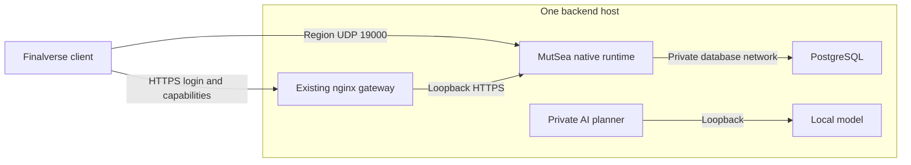

# Finalverse backend — single-host pilot

Verified 2026-10-15. MutSea is Finalverse's authoritative server/runtime. A single Linux host runs the existing HTTPS gateway, native MutSea simulator, dedicated PostgreSQL and a private local-model planner. The websites are published independently. No other site's machine participates in the application path; an outside machine is used only to test internet reachability.



The planner currently has no public route. Its live verification used observations from the authenticated World capability, projected through the gateway's bounded `scoped_context`. Models return proposals; native policy, human approval, World/Place execution and WorldLine remain the mutation boundary. Connecting a distributed viewer to server-side inference still requires an authenticated planning path. The existing localhost client setting does not automatically connect to this private service.

## Reproducible deployment

`deploy/standalone/Dockerfile` builds the native simulator and `Finalverse.World.dll` from the same source. Enable only the required modules in private configuration. `compose.finalverse.yaml` creates a separate Compose project with two networks: an internal database network and simulator runtime egress. Native grid startup resolves its advertised public hostname; making both networks internal prevents that startup. PostgreSQL publishes no port. The native TLS listener is published on loopback only; nginx verifies its certificate. Region UDP is separately published on an explicit bind address.

Private environment inputs:

| Variable | Required value |
| --- | --- |
| `FINALVERSE_OPERATIONS` | Absolute operator directory containing private PostgreSQL administrator secret and initialization SQL |
| `FINALVERSE_CONFIG` | Private native INI files, TLS bundle, pinned catalog and newcomer selections |
| `FINALVERSE_DATA` | Persistent writable scene/runtime/WorldLine directory |
| `FINALVERSE_POSTGRES_IMAGE` | Inspected PostgreSQL 16 image digest |
| `FINALVERSE_MUTSEA_IMAGE` | Source-built simulator image digest |
| `FINALVERSE_TLS_PORT` | Unused loopback-only host port |
| `FINALVERSE_UDP_BIND` | Deliberate host region-UDP bind address |

The application database is `finalverse`, separate from other applications. Its role owns the schema and has no superuser, database-creation, role-creation or replication privileges. Private native connection strings must retain Nini's double quotes around semicolon-separated values. Initialization SQL must be readable by the pinned PostgreSQL image's actual UID: Alpine uses 70, not Debian's 999. Keep its credential-bearing SQL owner-only. The health check requires both the final TCP listener and the initialized application database; the temporary initdb socket cannot make MutSea start prematurely.

Run from the repository root with an owner-only environment file outside Git:

```sh
docker build --platform linux/amd64 -f deploy/standalone/Dockerfile -t mutsea:verify .
docker compose --project-name finalverse-backend \
  --env-file /private/backend/runtime.env \
  -f deploy/standalone/compose.finalverse.yaml up -d
```

Record the resulting immutable digest privately before changing the runtime. Avoid displaying rendered configuration or secrets in shared logs. A fresh world uses the existing native template provisioning and package preflight. Never replay seed/import commands over an edited world, transfer unrelated account databases or implicitly upgrade an accepted template.

## Network acceptance

HTTPS websites/login and UDP region streaming are separate paths. Docker forwards UDP 19000 and an explicit UFW rule allows it. The initial router range ended at 3000, excluding the region port; outside probes did not arrive. After the operator's forwarding change, signature-marked packets reached the physical interface from outside the LAN, and real native login/stream/logout passed through the public DNS and HTTPS origin with strict TLS. No private DNS or UDP translation was used for this external proof.

If the host is already the router's DMZ target, a separate forwarding rule should normally be unnecessary. Verify the actual DMZ destination against the host's current LAN address, DHCP reservation, router WAN address and advertised DNS. If using explicit forwarding, map **UDP external 19000 to the backend host's UDP 19000**. Root on Linux can change the host firewall; it does not imply authenticated router administration. Do not disable firewalls or publish database, console or unauthenticated planning services to solve this.

The authenticated Deco web interface exposes status/system controls, but its DMZ search returned no results. Its supported forwarding workflow is in the [Deco app](https://www.tp-link.com/uk/support/faq/1797/). The operator reported a one-entry-per-device limitation and expanded an existing TCP+UDP range to 19000. That also forwarded unrelated Docker-published TCP ports. The host now applies an owned, persistent `DOCKER-USER` guard to newly arriving external traffic for the added range: TCP 3001–19000 and UDP 3001–18999 are blocked; the previous 1–3000 routing, UDP 19000, LAN traffic and established flows are preserved. It matches original destination ports using connection tracking, because Docker has already performed DNAT there. See [Docker's firewall guidance](https://docs.docker.com/engine/network/firewall-iptables/). Nine TCP ports in the newly expanded range were independently checked as unreachable from outside, while SSH/HTTP/HTTPS remained reachable. This verifies the observed IPv4 route, not every possible network topology.

The grid gateway ACL remains closed to general internet clients. The external native proof used a five-minute, exact-source allowance for the owned test host, armed for automatic expiry before installation. The allowance was removed explicitly after each test; the original gateway configuration was restored byte for byte, and the outside route again returned its intentional 503. The named smoke mode `--maple-early-access` refuses arbitrary endpoints/accounts and accepts only the defined private pilot fixture. Earlier tests using private DNS/namespace UDP translation remain private-route evidence; they are not the external acceptance receipt.

The inherited development SDK accepted chain and hostname errors. An actual callback test failed against the earlier probe binary. `tools/MutSea.ProtocolSmoke/build.py` now tightens both callbacks in the pinned **test SDK only** and runs ten actual-library TLS checks before producing a probe. It rejects missing certificates, untrusted chains, wrong names and combined errors. Rebuild probes with an explicit `ProbeBin` pointing to that SDK; do not accidentally use simulator libraries or assume an old source checkout describes a copied binary. The final outside proof used this strict build. No viewer/server DLL was replaced for this diagnostic correction. Earlier receipts are retained but do not prove strict SDK certificate validation.

## Pilot provisioning and maintenance

[Pilot admission](pilot-admission.md) stages an operator-approved, pinned character/Harbor selection into the existing native pipeline. It creates no anonymous registration endpoint. Native activation waits for verified owned appearance, inventory and dry home. Confirmed admission replay preserves user changes and credentials.

Before maintenance, inspect native active sessions and let clients log out. Temporarily disable the simulator container's automatic restart, then use its native `backup` and `shutdown` commands and confirm normal exit. An unconditional Docker stop may interrupt world persistence; a native shutdown with automatic restart still enabled immediately restarts the simulator. Keep PostgreSQL running for its consistent `pg_dump -Fc` and role dump, and retain matching configuration, catalogs and runtime journals privately. Restart only the owned simulator, verify preservation, then restore its restart policy. Do not change adjacent services or delete data volumes.

The latest stopped-runtime backup was restored into a separate verification database. Full rows and hashes matched all 31 native tables; the original database remained unchanged. Only that owned verification database was removed afterward. Reverting to an older database would discard later accounts/edits, so image rollback is not permission to restore old user data. The older module also lacks the optional admission field: review input compatibility before any rollback.

The native PKCS12 certificate is currently valid and trusted. Certbot's existing nginx-only hook does not refresh the simulator's loaded certificate. A local export plus session drain/native restart and verification must be integrated before unattended public operation; no cross-site SSH is needed for the single-host design.

## Verification record and remaining product work

- Linux x86-64 source image built: four inherited solution warnings, no errors; separate module and native probe built without warnings/errors.
- 56 World kernel checks, 21 real native provisioning/concurrency checks, 17 admission validation/replay checks and 12 operator-staging tests passed.
- Native private-route login for the existing builder and fresh admitted architect confirmed selected home, all 422 object identities/mesh bindings, three semantic contexts, eight owned Current Outfit links and normal logout. Login/stream took approximately 3.75 and 2.96 seconds respectively. This is a bounded protocol check, not a rendered population benchmark.
- Clean restart preserved complete scene, appearance, inventory and account row hashes and all World/Place/Genesis/admission journals, with no duplicate admission.
- 70 gateway tests passed on the backend. Real local inference answered structured world inspection in approximately 24 seconds and produced a schema-valid six-person picnic-place draft/WorldSpec in approximately 22 seconds. Neither inference mutated the 422-part scene.
- PostgreSQL restore matched all 31 native tables. The final strict-TLS outside native proof confirmed home entry, all 422 mesh/object bindings, three semantic places, eight owned outfit links and normal logout in approximately 3.24 seconds. Appearance transmission was disabled. Complete scene/shape/appearance/inventory/account row hashes and all journals matched afterward. The temporary grid allowance was removed and the transferred credential file deleted from the test host.
- The pinned strict diagnostic SDK built with 76 inherited warnings and no errors; the native world probe built without warnings/errors. Ten TLS callback checks passed. No new simulator or viewer rebuild was required for this test-tool correction.

The next product slice is authenticated server planning for the viewer and a controlled first-use pilot that chooses a supported avatar, enters Harbor and saves/remixes an approved creation. Public invitation redemption, user-controlled registration/recovery, abuse controls, native TLS renewal and client distribution are not implemented by the operator admission CLI. Outside transport acceptance now passes for the controlled test identity; this does not open public admission. Premium art and broad device/load acceptance remain separate release work; neither should cause repeated already-accepted screenshot loops.
