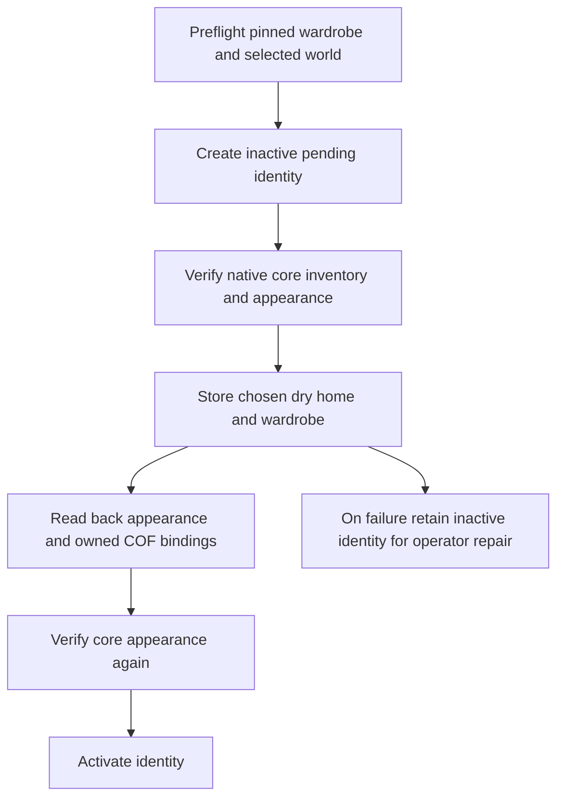

# Selected appearance and home before account activation

An operator-selected Genesis wardrobe used to run after the inherited account service activated the default appearance. A non-wearable AI citizen representation therefore could leave an active account with the default outfit when its selected wardrobe failed. A local multi-account test exposed this boundary. Public registration must use the complete provisioning path, not activate an identity and then apply its chosen character asynchronously.

`UserAccountService.CreateUserWithProvisioning` adds a trusted in-process completion callback to the existing account implementation. The inherited `CreateUser` method and optional model argument retain their ABI and behavior. No anonymous registration handler, new identity store, public endpoint or client privilege is added.

Deploy the updated `Finalverse.World.dll` with the matching `MutSea.Services.UserAccountService.dll`; the new module calls the added completion method. This slice integrates that pair only on the named local hero fixture. Other established grids retain their previous tested binaries. A later rollout needs their normal session check, native backup/shutdown, matched pair, guarded restart and preservation verification.

`FinalverseAccounts` preflights every selected directory through `AvatarCatalog.LoadWardrobe` before creating any identity. It verifies the compiled pin, native payloads, current canonical template, attachment representation and alpha layer. Animated citizen representations and the retired provisional Elara Male template are refused. A configured provisioned world must be active before newcomers are created. New accounts get the chosen experience's validated native arrival; existing users retain a valid home, and only missing homes are filled.

The completion runs while `UserLevel=-1000` / provisioning state `pending`. Native home storage/readback and Genesis wardrobe verification finish before activation at level 0. Failure retains the identity, inventory and assets at level `-1001` / state `failed`; no automatic deletion or blind retry conceals partial work. Extended completion is refused before identity creation when required default appearance verification is disabled. The callback is server code, never model output or arbitrary remote executable code.

Wardrobe selection validation also precedes rollback of an existing Genesis assignment. Existing successful assignments remain idempotent and user-edited appearance is preserved. New assignments require `SetAppearance` acknowledgment, alpha readback, attachment item/point readback and owned Current Outfit links to the correct object/alpha assets. The inherited appearance store deliberately omits attachment asset IDs; those resolve from inventory at login. Verification follows that contract rather than rejecting a valid zero attachment asset ID on database readback.

## Local native evidence

- 21 provisioning/concurrency tests pass, including callback execution while pending, callback failure with no active write, default-off refusal and prior authentication/inventory/appearance/activation faults.
- Four native package preflight checks accept a pinned Auren wardrobe and refuse a wrong pin, Lumi's animated representation and the retired provisional male template. They perform no identity/inventory mutation.
- The named hero fixture refuses a non-wearable choice before creating its requested identity. A fresh supported account records `account_created` / `home_set` at -1000, then `account_activated` at 0 after native wardrobe completion. Existing inventory/appearance rows and all 422 persistent scene rows are preserved.
- The final source integration provisions a separate account at the selected dry home `[128,123,23.5]`, confirms native home entry / 422 parts / eight COF links / logout, and preserves prior homes, inventory and appearance. A native login attempt for the retained failed identity is refused before world entry. Clean final restart preserves all scene rows and both World/Place journals without duplicate provisioning.
- Six distinct supported accounts (Auren, Elara, masculine/feminine Kai, feminine Terra and feminine Ignis) pass native home entry, all 422 linked mesh bindings, three semantic world/place contexts, eight COF links with native ownership, overlapping 10-second connected holds and normal logout. Local login plus complete streaming ranges about 3.291–3.375 seconds. This is a bounded protocol smoke, not rendered-avatar capacity or public registration acceptance.
- Diagnostic identities remain inactive with their evidence intact. One revealed the original non-wearable-selection problem; another exercised inactive retention when a new readback check incorrectly assumed persisted attachment asset IDs. The check was corrected from actual source before acceptance. No user identity was deleted, renamed or re-keyed.

`tools/MutSea.WorldTemplateSmoke/load.py` coordinates 2–6 unique private accounts only on the named loopback hero fixture. Raw SDK logs and account files stay private. It validates all normal logout receipts and exact native UTC hold intervals; .NET's variable fractional digits are parsed as 100 ns ticks for Python 3.9 compatibility. A summary-format failure was corrected from the completed receipts without repeating logins. It cannot target a public grid or log in the same account concurrently.

Public signup, invitation/admission policy, recovery UI, character/experience selection, abuse controls, a first-time user study and distribution remain open. Future registration must invoke the same verified native completion path with server-controlled choices. Phase 4B stays open; no public service was deployed.
