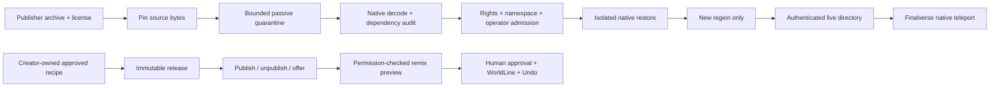

# MutSea World Library v0.1

MutSea is the spatial runtime and authority; Finalverse is its flagship client. The World Library connects curated source scenes, original world templates, live region discovery and an initial creator recipe registry. It wraps the inherited archive, asset, inventory, grid and teleport services.

[Live region names and October 18 acceptance](world-library-acceptance-20261018.md).

## Current boundaries

The deployment is a PostgreSQL-backed standalone multi-region grid. It is not yet a federated multi-tenant spatial cloud. Regions share mature identity, asset and inventory services. Account provisioning stays on its configured host region. `[FinalverseCitizens] HostRegion` scopes the existing Lumi controller to its intended region. An enabled citizen controller must specify its host when a multi-region library is configured. Existing single-region fixtures retain their former behavior if that optional setting is absent.

`[MutSeaLibrary] Catalog` names a bounded private operator manifest. `WorldLibrary.cs` validates region identities, spawn bounds, reviewed license classes, pinned original templates and optional workspace zones. It does not fetch URLs. Additional original templates can be provisioned per-region through the existing `WorldTemplateKernel`. Catalogs, content pins and journals remain separate from legacy scene objects.

The authenticated World capability adds:

| Operation | Behavior |
|---|---|
| `destinations` | Operator destinations joined with actual local grid registration and online flags. Returns global origin and local spawn for native teleport. No private configuration paths. |
| `inspect` | Existing bounded scene inspection, with an optional workspace zone context. |
| `creator`, `command=list` | Your immutable recipes and published listings. |
| `creator`, `command=save` | Snapshot your active committed composition recipe after native fingerprint and ownership checks. |
| `creator`, `command=publish/unpublish` | Owner-only listing management. `price_minor` and currency describe an offer; `checkout_enabled=false` always. |
| `creator`, `command=remix` | Permission-checked composition preview using pinned approved assets. Commit and Undo use the existing transaction path. |

Actor identity comes from the active capability/session and root presence. Native logout revokes authority before its UDP acknowledgement, and client closure invalidates the region session; a lingering presence cannot keep a logged-out capability alive. No supplied owner UUID grants authority. Discovery has a separate throttle from human world actions. Creator releases are content-addressed files beside the existing WorldLine journals, not a replacement identity database. Native identity and inventory remain in PostgreSQL. Private release metadata and listing visibility survive restarts; atomic listing replacement preserves immutable content. This initial registry accepts only approved CC0 recipes, not arbitrary user archives or declarations of asset rights.

## Archive admission

`tools/MutSea.Library/ingest.py` acquires the allowlisted publisher sources under download/time/size budgets, records hashes and uses the existing quarantine converter. Deferred and rejected outcomes remain visible. There is no archive extraction onto a runtime filesystem or automatic production restore.

`MutSea.OarAudit` deserializes passive objects with the native serializer and checks part counts, task-inventory removal and declared texture/sculpt references. Missing references are a separate gate; deserialization does not prove appearance, decoded texture validity, collision quality or frame rate.

An explicit `--rekey-white` transform isolates publisher copies of the common blank texture UUID. It rewrites native texture bindings, retains texture bytes and creator attribution, and records upstream source/passive hashes and the deterministic replacement ID. The output is quarantined and audited again. This avoids overwriting the runtime's existing asset. Other UUID conflicts still fail admission.

`LibraryProvisioning.cs` invokes the **per-region** `IRegionArchiverModule` on an empty newly allocated region. It requires exact artifact/report pins, both script engines disabled and no conflicts with existing asset bytes. Import receipts distinguish pending, committed and failed states. Interrupted/failed restores require operator recovery and are never replayed over partial content. Only a confirmed matching receipt makes an imported destination available in the directory.

The admission policy remaps unknown source owners through the native estate-owner mechanism, verifies ownership, retains creator attribution, allows visitors to copy the CC0 samples and prevents visitors from editing the shared originals or rezzing/terraforming their parcels. Inherited sale flags and Buy/Pay click actions are disabled; imported samples do not imply a payment service. Users edit copies on permitted land. Native restoration is an operator operation, not an atomic WorldKernel transaction. Rollback removes only the new region and restores its pre-import snapshot; shared assets are not blindly deleted.

The cloud upload/import path remains operator-only. No browser or AI can submit an arbitrary OAR, URL, filesystem path or privileged role.

## Acquisition record

`deploy/library/sources.json` records the canonical publisher revision, license-evidence hash and fetched source pins. `acquisition-20261018.json` records every outcome: 28 compatible-source URLs attempted, 13 quarantined and natively deserialized; 15 rejected by format/size/integrity gates; two Aurora/WhiteCore entries and mixed-license OpenVCE deferred. Some accepted scenes have incomplete dependencies or unsuitable budgets and remain staged. The manifest is a source inventory, not evidence that every scene is online or visually accepted.

Publisher evidence: [Zadaroo source repository](https://github.com/hack13/Zadaroo), [publisher licensing](https://www.zadaroo.com/licensing.html), [CC0 terms](https://creativecommons.org/publicdomain/zero/1.0/), [OpenVCE contributor notes](https://openvce.net/downloads/2022/Readme-OpenVCE-Assets.txt). The source list is pinned to Zadaroo revision `5d46d3d89e2fd0da2e4b19b1f57a676a2e512994`. A publisher declaration does not establish third-party trademark, privacy or endorsement rights. Attribution is retained even when the declared copyright license does not require it.

## Confluence and next boundaries

Confluence v0.1 is an original reusable island template, with a Conversation Circle, Review Pavilion and Quiet Shore. Its current innovation is a shared semantic spatial context for the authenticated planner and reviewed world creation. It does not yet create a private chat room or independent autonomous agents just because avatars sit together.

Next: explicit workspace sessions and participant consent; private threads and artifact references; bounded agent identities/tools/budgets; editor-neutral WorldSync; portable creator releases with dependency/license resolution; then payment, payout, moderation and commercial entitlement infrastructure. These use the same identity and transaction authority rather than an AI-controlled parallel world database.
