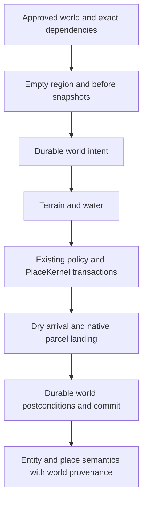

# Original island templates and guarded world provisioning

MutSea provisions approved WorldTemplates through the existing WorldTemplateKernel and PlaceKernel. Studio is an authoring surface; MutSea assigns canonical instance IDs, enforces native parcel policy, persists state and records WorldLine. Imported OAR compatibility remains a separate gate with separate provenance.

## Starter Library additions

Studio `scripts/build_place.py --place coastal-reading-nook` produces `mutsea.starter.coastal-reading-nook@0.1.0`: two bench v0.1.8 instances and two path-lantern v0.1.2 instances, with semantic roles and an approach. This derives a reusable composition from the accepted shoreline recipe without carrying that instance's UUIDs, ownership or journal.

`scripts/build_world.py --world aurens-island --places /absolute/approved-places --water-height 20 --output /absolute/new-world` produces `mutsea.starter.aurens-island@0.1.0`. Its original deterministic R32 terrain has a level interior, coastal shelf and surrounding water. Four exact place-manifest hashes pin Harbor Arrival, Harbor Pavilion, Coastal Reading Nook and Coastal Fire Circle. They contain 134 linked groups / 498 parts. `provenance.json` records the generator, terrain, world and dependency hashes, original authorship and CC0 content intent. No imported OAR assets or terrain are relabeled as original. The environment preset is a reference; this command does not publish an EEP asset.

Generate a new package/version to remix the terrain, water or composition. Existing nonempty output directories are refused. Auren's Island v0.1 refuses an external heightfield or a different water level. Approved content/places remain operator supplied; neither models nor clients can choose server filesystem paths, upload executable authoring code or expand the catalog.

## Native transaction and recovery

World rollback first verifies the before-terrain snapshot, compatible postconditions, current terrain/water/parcel landing, **every** place's native fingerprints/delete policy, and absence of later unrelated objects. These checks precede the world rollback intent and all deletions. Each place repeats its preflight immediately before deletion. Rollback restores the prior terrain, water and parcel landing position/facing/type. Failed or interrupted compensation fences writes across the world, place, composer and content kernels, including citizen requests. Inspection reports that same aggregate recovery state. This is guarded compensation over mature runtime services, not one atomic cross-service database transaction; failures after intent require operator recovery.

Terrain needs two distinct hashes. The manifest pins exact source R32 bytes, and the before snapshot pins its retained R32 file. The postcondition `terrain_after_sha256`, with `terrain_hash_format=mutsea-variable2dgzip-r32-v1`, fingerprints the inherited durable terrain representation. `TerrainData.GetDatabaseBlob` rounds heights to three decimal places in Variable2DGzip storage; the adapter roundtrips that serializer and hashes its row-major float heights. It uses no arbitrary epsilon and does not change the renderer or terrain database format. A raw-float prototype correctly refused rollback after restart before any deletion; its journals were retained rather than rewritten.

Older WorldLine entries remain readable and idempotent. Entries without landing, terrain/water postconditions and a compatible format **refuse automatic rollback**. Do not backfill them from current state and call that proof of the original state. Review old operations explicitly before any migration. Existing Harbor/OpenVCE/Tropical deployments were not upgraded during this isolated verification.

Entity semantics add `world_template` with world ID/version/manifest hash, region, master operation and containing place plan. The sidecar resolves from native journals, survives restart, and excludes rolled-back worlds/places. It does not alter inherited scene-object IDs or structures.

## Newcomer arrival

The inherited account service validates initial body/clothing assets, inventory and Current Outfit before activation. The operator newcomer adapter checks a nine-sample dry, level standing footprint before creating an account, fills only a missing home through native GridUserService, and reads it back before `newcomer_ready`. Optional Genesis assignment still uses the pinned wardrobe pipeline. Existing passwords, nonzero homes, user-selected appearance and inventory are preserved.

The previous Tropical test account's zero HomeRegionID explains its home-login fallback. It was diagnosed read-only and left untouched to preserve the user's viewer session. A newly provisioned home is validated independently by native home login; this does not claim the existing Tropical account has been repaired or the full public registration UI accepted. The terrain check does not replace continuous collision, appearance baking or native visual onboarding tests.

## Verification

`tools/MutSea.ContentTests` covers full rollback, parcel landing restoration, later terrain/water/landing/object/early-place edit refusal before intent, historical journal refusal, dry/level arrival and failed-world compensation. Studio world/place tests cover deterministic generation, exact pins, coast/arrival geometry, original provenance, foreign-terrain rejection and output preservation.

`tools/MutSea.WorldTemplateSmoke` is restricted to a private loopback fixture. It verifies a home login without safe fallback, native RegionID plus authenticated World.inspect, all expected linked mesh IDs, Current Outfit/core wearables/Genesis bindings, native inventory ownership, world/place semantic provenance and normal logout without sending appearance. The old probe SDK reads per-item `agent_id`; native inventory carries ownership in `permissions.owner_id`. The probe checks the authenticated raw FetchInventory2 response rather than accepting SDK zero-owner defaults or changing the server contract. Capability URLs and private accounts must stay out of logs, argv and repositories.

The source module and probe build with zero warnings/errors; 50 content tests and nine Studio world/place tests pass. Native restart/rollback/reprovision results are recorded in the companion acceptance document when completed. Final art, first-session UX, continuous collision/LOD, controlled performance and distribution approval remain open. Phase 4B remains open.
